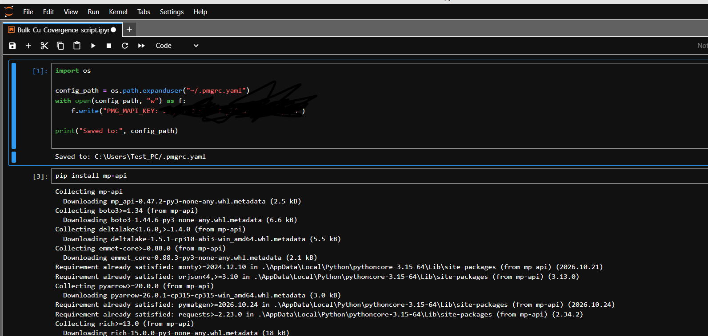
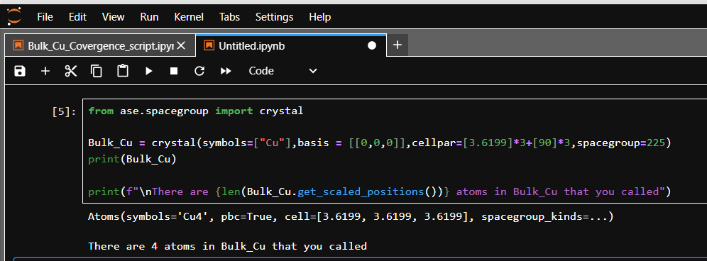
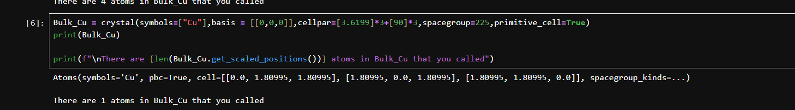
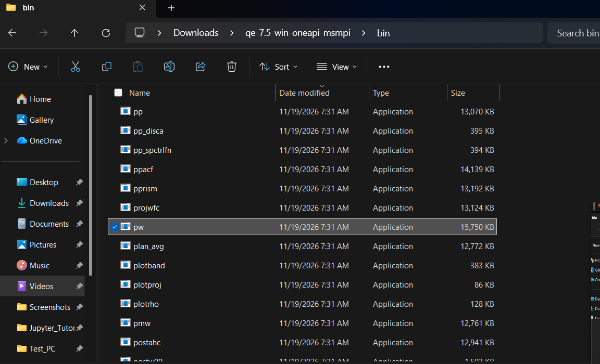
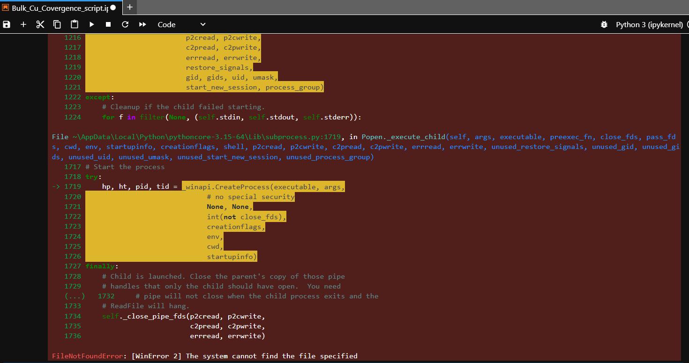
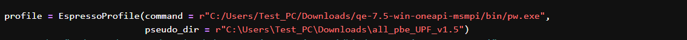
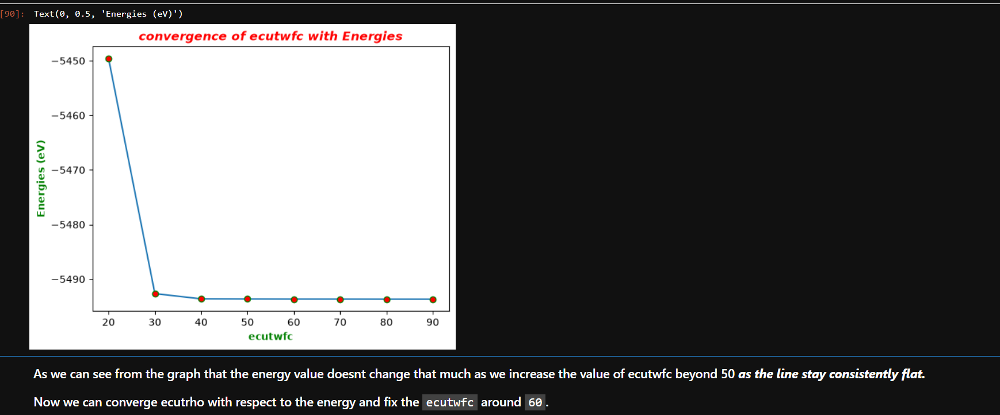
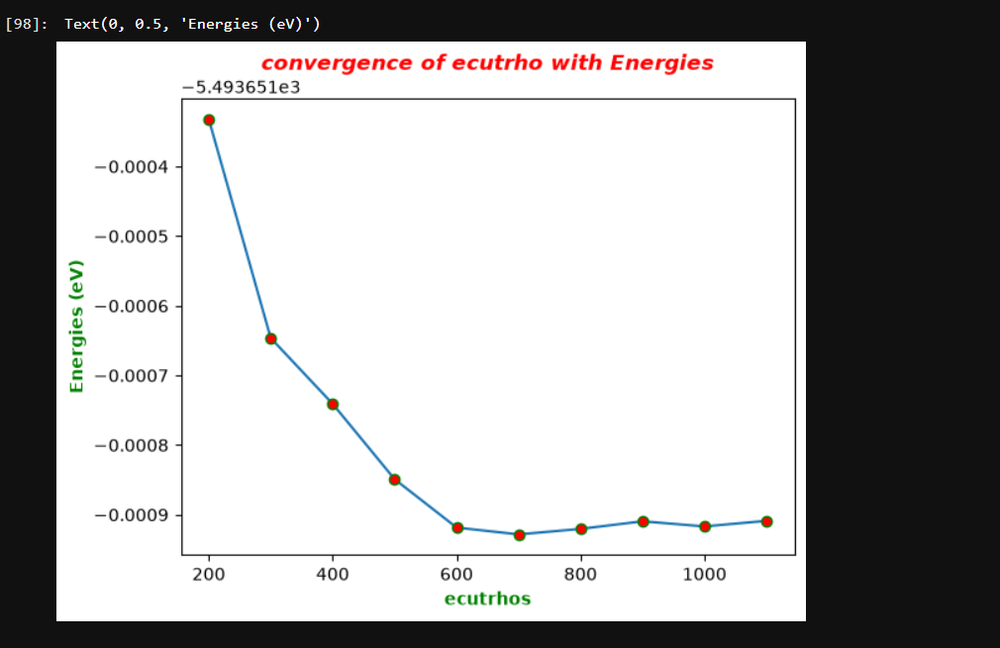

Before running important Density Functional Theory (DFT) calculations—such as variable-cell relaxations, or electronic band structures or even phonon calculations—you must converge your plane-wave cutoff parameters for the specific pseudopotential and exchange-correlation functional that you plan to use.

In this tutorial, we determine the optimal DFT input parameters for **bulk FCC Copper (`mp-30`)** using the **Atomic Simulation Environment (ASE)** and **Quantum ESPRESSO (`pw.x`)**:
* **`ecutwfc`**: Kinetic energy cutoff for wavefunctions (in Ry) : plane waves repeat infinitely. We need to find a balance where we truncate the kinetic energy cutoff for the wavefunction for our specific material (bulk copper in this example). Normally, we would require cutofs of thousands of Ry (because real electrons oscilates very widly near the nucleus, but since we are using pseudopotentials which replaces those tight electrons with a smooth effective potentials so the calculation becomes more tractable and we can make do with lower cutoffs for wavefunctions. But we need to converge this cutoffs for our specific so we can find the atomic arrangements that is best for our system.
* **`ecutrho`**: Kinetic energy cutoff for charge density and potential. The default 4 * ecutwfc is Quantum Espresso is sometimes insufficient.
* **`etot_conv_thr` & `conv_thr`**: Total energy and self-consistent field (SCF) electronic convergence thresholds.

*(Note that if you haven't installed JupyterLab, ASE, and Pymatgen yet, check out my [Step-by-Step Installation Guide](/tutorials/2026-11-19-installing-jupyterlab-materials-science/) first.)*

---

## Step 1: Set Up Your Materials Project API Key

Fetching crystal structures directly from the **Materials Project** can save us some time compared to building cells manually. To query the database without pasting your API key into every notebook, save it once to your home directory's `.pmgrc.yaml` configuration file (more explanation below).

1. Create a free account at the [Materials Project](https://materialsproject.org) and copy your API key from your dashboard.
2. Install the official `mp-api` client and save your key to `~/.pmgrc.yaml`:
3. For me, I already have my `keys` as shown in the image below (key covered). That way I query the relaxed bulk copper from MP. The materials project optimize their systems (finding the best atomic arrangements for different materials) using the VASP code and certain combinations of DFT functionals. But just because they have optimize the system doesnt mean we should not optimize it too because for the most part, we are using a different calculator (Quantum Espresso) different than VASP. And most likely, we will be using different pseudopotentials. Results obtained for specific system are only true under the set of conditions where they were obtained, though the underlying physics and trend is generally the same across material families.Initally, I didnt know the MP ID for the face centered cubic bulk copper that I wanted to use, but I did a quick google search **"materials project ID for bulk copper"** and I immediately know the most thermodynamically stable bulk copper crystalizes in the fcc crystal structure and the materials project id is actually `"mp-30"`. This is the material we would be working on.
4. Once you have your MP API key, you can save it permanently so you never have to input it everytime as shown below.


```python
!pip install mp-api
```

```python
import os

config_path = os.path.expanduser("~/.pmgrc.yaml")
with open(config_path, "w") as f:
    f.write("PMG_MAPI_KEY: YOUR_MATERIALS_PROJECT_API_KEY\n")

print("Saved to:", config_path)
```

> **Security Note:** Never share your real `PMG_MAPI_KEY` to a public GitHub repository or blog post. Storing it in `~/.pmgrc.yaml` lets `MPRester()` to see it automatically behind the scenes. I do not reveal mine in this post. I guard it like my life depend on it😒



---

## Step 2: Import Libraries and Retrieve the Crystal Structure

There are three common ways I, particularly, get a starting crystal structure in Python:
1. **Materials Project (`MPRester`):** Query a relaxed structure directly by its Material ID (`mp-30`).
2. **ASE `crystal()`:** Build a structure from crystallographic data (such as an ICSD entry) by giving it the element symbols, Wyckoff `basis` positions, `cellpar` lattice constants, and `spacegroup`. I notice that that `crystal()` returns the 4-atom conventional FCC cell by default unless you pass `primitive_cell=True`. Once you flag it with primitive_cell=True, it returns a one atom cell.

   

   
   
4. **ASE `bulk()`:** Once can quickly generate elemental crystals by passing the symbol and crystal name (e.g., `bulk("Cu", "fcc")`). This saves us the stress of having to input the experimental lattice constant `a` like we did for the crystal() function.

```python
from ase.build import bulk
from ase.spacegroup import crystal
from mp_api.client import MPRester
from pymatgen.io.ase import AseAtomsAdaptor as converter
import numpy as np

# 1. Fetch relaxed primitive cell from Materials Project
with MPRester() as mpr:
    structure = mpr.get_structure_by_material_id("mp-30")

# 2. This buid a 1-atom primitive cell from ICSD crystallographic parameters (I used Collection Code 136042)
Bulk_Cu = crystal(
    symbols=["Cu"],
    basis=[[0, 0, 0]],
    cellpar=[3.6199] * 3 + [90] * 3,
    spacegroup=225,
    primitive_cell=True,
)

# 3. Quick elemental construction using ASE's bulk builder. The tolerance matching here is just to check whether the two methods return identical
crystal. np.isclose() can also work fine here. 
Bulk_copper = bulk("Cu", "fcc")

print("MP Structure:\n", structure)
print("ASE crystal() cellpar:", Bulk_Cu.cell.cellpar())
print("ASE bulk() cellpar:", Bulk_copper.cell.cellpar())
print("Lattice parameters match within tolerance:",np.allclose(Bulk_Cu.cell.cellpar()[:3], structure.lattice.abc, atol=1e-3, rtol=2e-2))
```

**Output:**
```text
Full Formula (Cu1)
Reduced Formula: Cu
abc   :   2.529625   2.529626   2.529625
angles:  60.000012  60.000004  60.000003
pbc   :       True       True       True
Sites (1)
  #  SP      a    b    c
---  ----  ---  ---  ---
  0  Cu     -0   -0   -0
[ 2.55965584  2.55965584  2.55965584 60.         60.         60.        ]
[ 2.55265548  2.55265548  2.55265548 60.         60.         60.        ]
True
```

---

## Step 3: Download Quantum ESPRESSO & Pseudopotentials

Before running single-point self-consistent field (`scf`) convergence tests—and later variable-cell relaxations (`vc-relax`)—you need two external components that you have to get online:
1. **Pseudopotential (`.UPF`):** Download the PBE ultrasoft pseudopotential library from the [GBRV Pseudopotential Library](https://rutgers.edu) (scroll down and download the **PBE UPF** archive for Quantum ESPRESSO) and extract it to a local folder on your laptop.
2. **Quantum ESPRESSO (`pw.x`):** Windows users can download precompiled binaries from the [QMatSuite Quantum ESPRESSO Windows Releases](https://github.com) page (select the latest `qe-7.5-win...` archive) and extract it.

> **Why Converge Cutoffs on a Coarse k-Point Grid First?**
> Testing high wavefunction cutoffs (`80–100 Ry`) on a dense k-point mesh (`16×16×16`) is computationally expensive. Running cutoff convergence on a smaller, fixed k-point grid (`4×4×4`) keeps each calculation fast. Once the optimal `ecutwfc` and `ecutrho` are now established, we can run a separate k-point convergence test at those converged cutoffs.

*(Note: Once you are ready for structural relaxation in a follow-up step, you can either set `calculation="vc-relax"` directly inside Quantum ESPRESSO's `input_data`, or keep `calculation="scf"` and wrap your `Atoms` object in ASE's `FrechetCellFilter` or `ExpCellFilter` together with an ASE optimizer like `BFGS`.)*

---

## Step 4: Converge Wavefunction Cutoff (`ecutwfc`)

Now we loop over `ecutwfc` values from `20 Ry` to `90 Ry` while holding `ecutrho = 720 Ry` and `kpts = (4, 4, 4)` constant. Because Copper is a metal, we also include Gaussian smearing (`occupations="smearing"`, `smearing="gaussian"`, `degauss=0.05`) to smoothly integrate electronic states near the Fermi level.

### Setting Up the `pw.exe` Path on Windows (and Avoiding Common Errors)

1. Open the folder where you extracted Quantum ESPRESSO (or your pseudopotentials), locate **`pw.exe`** inside the `bin` subfolder, **right-click** on it, and choose **Copy as path**:



2. When you paste that path into `EspressoProfile(command=...)`, Windows uses backslashes (`\`). I noticed when I left that backslashes like that in `command`, Quantum ESPRESSO fails to find `pw.exe`:



3. **The Fix:** Replace all backslashes (`\`) with **forward slashes (`/`)** in `command` Once updated, the calculation runs smoothly:



4. The actual pseudopotentials for all the elements must be wrapped in a python dictionary like below. And you can specify other convergence parameters, DFT functional that you want to use, and various other Quantum espresso infomation in a variable called `input_data` just like below. Note that when I passed the profile inside the Espresso calculator, I copied the input_data for each run. This is to avoid data overwriting each other in the loop. Safer that way.


```python
import os
from ase.calculators.espresso import Espresso, EspressoProfile

# Update these two paths to match where you extracted pw.exe and the GBRV UPF files
profile = EspressoProfile(
    command=r"C:/Users/Test_PC/Downloads/qe-7.5-win-oneapi-msmpi/bin/pw.exe",
    pseudo_dir=r"C:\Users\Test_PC\Downloads\all_pbe_UPF_v1.5",
)

pseudopotentials = {"Cu": "cu_pbe_v1.2.uspp.F.UPF"}

input_data = {
    "calculation": "scf",
    "input_dft": "pbe",
    "ecutrho": 720,
    "etot_conv_thr": 1e-6,
    "forc_conv_thr": 2e-5,
    "conv_thr": 1e-7,
    "occupations": "smearing",
    "smearing": "gaussian",
    "degauss": 0.05,
}

testing_ecut = [20, 30, 40, 50, 60, 70, 80, 90]
Energies = []

for ecut in testing_ecut:
    input_data.update({"ecutwfc": ecut, "prefix": f"bulk_Cu_scf_{ecut}"})
    calculator = Espresso(
        profile=profile,
        kpts=(4, 4, 4),
        input_data=input_data.copy(),
        pseudopotentials=pseudopotentials,
        directory=os.path.join(".", f"bulk_Cu_scf_{ecut}"),
    )
    Bulk_Cu.calc = calculator

    energy = Bulk_Cu.get_potential_energy()
    print(f"The single point energy for Bulk_Cu_scf_{ecut} is: {energy}")
    Energies.append(energy)
```

**Output:**
```text
The single point energy for Bulk_Cu_scf_20 is: -5449.547926451428
The single point energy for Bulk_Cu_scf_30 is: -5492.6549217001575
The single point energy for Bulk_Cu_scf_40 is: -5493.6151791912835
The single point energy for Bulk_Cu_scf_50 is: -5493.637434973976
The single point energy for Bulk_Cu_scf_60 is: -5493.651922042632
The single point energy for Bulk_Cu_scf_70 is: -5493.656022526066
The single point energy for Bulk_Cu_scf_80 is: -5493.667561785509
The single point energy for Bulk_Cu_scf_90 is: -5493.673230597053
```

### Plotting `ecutwfc` Convergence

```python
from matplotlib import pyplot as plt

plt.plot(testing_ecut, Energies, marker="o", mfc="red", mec="green")
plt.title("Convergence of ecutwfc with Energies", fontweight="bold", fontsize=12, color="red", style="italic")
plt.xlabel("ecutwfc (Ry)", color="green", fontweight="bold")
plt.ylabel("Energies (eV)", fontweight="bold", color="green")
plt.show()
```



As shown in the plot above, the total energy drops sharply between `20 Ry` and `40 Ry`, then levels flat beyond **`50–60 Ry`**. Fixing **`ecutwfc = 60 Ry`** gives a safe, well-converged wavefunction basis for the next test.

*(The individual scf files will be saved as a folder. In each folder, you can click to see the input file and the output files. The entire calculation took about 20 seconds to finish because this is just a one atom primitive cell for Copper. Calculation time scales with more atoms in the unit cell)*

## Step 5: Converge Charge Density Cutoff (`ecutrho`)

For ultrasoft pseudopotentials (like GBRV's `cu_pbe_v1.2.uspp.F.UPF`), the charge density varies much more rapidly than the wavefunctions, meaning Quantum ESPRESSO's norm-conserving default (`ecutrho = 4 * ecutwfc = 240 Ry`) is usually too low. Let's fix `ecutwfc = 60 Ry` and test `ecutrho` from `200 Ry` to `1100 Ry`:

```python
testing_erhos = [200, 300, 400, 500, 600, 700, 800, 900, 1000, 1100]

input_data = {
    "calculation": "scf",
    "input_dft": "pbe",
    "ecutwfc": 60,
    "etot_conv_thr": 1e-6,
    "forc_conv_thr": 2e-5,
    "conv_thr": 1e-7,
    "occupations": "smearing",
    "smearing": "gaussian",
    "degauss": 0.05,
}

Energies_rhos = []

for ecutrho in testing_erhos:
    input_data.update({"ecutrho": ecutrho, "prefix": f"Bulk_Cu_scf_{ecutrho}"})
    calculator = Espresso(
        profile=profile,
        kpts=(4, 4, 4),
        input_data=input_data.copy(),
        pseudopotentials=pseudopotentials,
        directory=os.path.join(".", f"Bulk_Cu_scf_{ecutrho}"),
    )
    Bulk_Cu.calc = calculator

    energy = Bulk_Cu.get_potential_energy()
    print(f"The single point energy for Bulk_Cu_scf_{ecutrho} is: {energy}")
    Energies_rhos.append(energy)
```

**Output:**
```text
The single point energy for Bulk_Cu_scf_200 is: -5493.6513319637725
The single point energy for Bulk_Cu_scf_300 is: -5493.651646391314
The single point energy for Bulk_Cu_scf_400 is: -5493.651740950872
The single point energy for Bulk_Cu_scf_500 is: -5493.651849116123
The single point energy for Bulk_Cu_scf_600 is: -5493.651918505152
The single point energy for Bulk_Cu_scf_700 is: -5493.65192830125
The single point energy for Bulk_Cu_scf_800 is: -5493.6519204099495
The single point energy for Bulk_Cu_scf_900 is: -5493.651909525395
The single point energy for Bulk_Cu_scf_1000 is: -5493.651916872469
The single point energy for Bulk_Cu_scf_1100 is: -5493.651908845111
```

### Plotting `ecutrho` Convergence

```python
plt.plot(testing_erhos, Energies_rhos, marker="o", mfc="red", mec="green")
plt.title("Convergence of ecutrho with Energies", fontweight="bold", fontsize=12, color="red", style="italic")
plt.xlabel("ecutrho (Ry)", color="green", fontweight="bold")
plt.ylabel("Energies (eV)", fontweight="bold", color="green")
plt.show()
```



From the plot above, the default `4 * ecutwfc` (`240 Ry`) has not yet settled. The energy seems to stabilizes once **`ecutrho = 600 Ry`** 

---

## Try This Next: Converge Your k-Point Mesh (`kpts`)

In this tutorial, we held `kpts = (4, 4, 4)` fixed to make the calculation go fast fast—which is too coarse for metallic calculations on Copper. Using your converged **`ecutwfc = 60`** and **`ecutrho = 600`**, try writing a loop over Monkhorst-Pack k-point grids—such as `(4, 4, 4)`, `(6, 6, 6)`, `(8, 8, 8)`, `(10, 10, 10)`, `(12, 12, 12)`, and `(16, 16, 16)`—and plot the total energy versus k-point density. 

---

