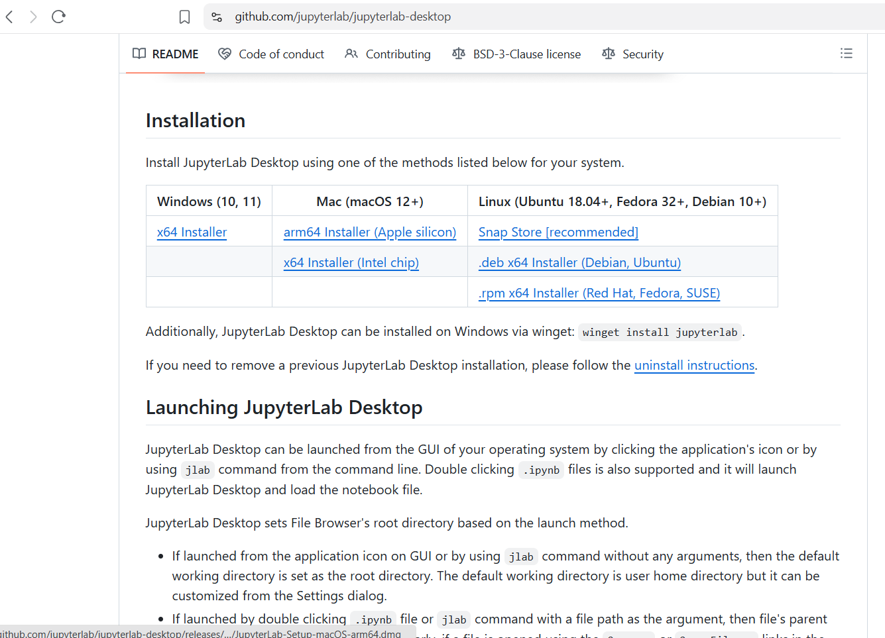

To get the most out of the computational materials science tutorials on this site, you will need a working Python environment with **JupyterLab** and a few quite important scientific libraries. Follow this step-by-step guide to set everything up from scratch on Windows.

---

## Step 1: Install Python and Add It to PATH

1. Open **Command Prompt** (`cmd`) and type `python` or `python3`.
2. If Python is not yet installed, Windows will open the **Python Install Manager** in the Microsoft Store. Click **Install** (or **Open** if already downloaded).

3. When the the installation setup opens in your terminal, type **`y`** when asked `Add commands directory to your PATH now? [y/N]`. Adding Python to your system `PATH` will let you to run Python commands from any folder.

4. Next, type **`Y`** to install the latest CPython runtime and wait for the download and extraction to finish.

---

## Step 2: Install JupyterLab

1. Close your old Command Prompt window and open a fresh one so the updated `PATH` takes effect.
2. Run the following command to install JupyterLab:

```bash
pip install jupyterlab
```

> **Troubleshooting `'pip' is not recognized`:** If you see an error stating that `pip` is not recognized as an internal or external command, use `python -m pip install jupyterlab` instead.

During installation, you may see yellow some messages saying that scripts were installed in a `Scripts` directory that is not on your `PATH`.


---

## Step 3: Launch JupyterLab

Once you're done with the installation, launch JupyterLab from Command Prompt by running:

```bash
jupyter lab
```

If you receive `'jupyter' is not recognized` because your `Scripts` folder is not on `PATH`, you have two options:
* **Quick launch:** Run `python -m jupyter lab` instead.
* **Permanent fix:** Open the Start menu, search for **Environment Variables**, click **Environment Variables...**, select **Path** under *User variables*, and add the `Scripts` folder path shown in the warning above.

JupyterLab will automatically open in your default web browser (or you can copy and paste one of the `http://localhost:8888/...` URLs printed in the terminal into your fav browser).

---

## Step 4: Install Materials Science Dependencies

1. On the JupyterLab Launcher screen, click the **Python 3 (ipykernel)** tile under **Notebook** to create a new notebook.
2. In a code cell, install **ASE**, **Pymatgen**, **Matplotlib**, and **Spglib** using `pip`:

```python
!pip install ase pymatgen matplotlib spglib
```

*(Prefixing commands with `!` tells Jupyter to run them as shell commands directly from the notebook cell. In newer Jupyter environments, `pip install ase pymatgen matplotlib spglib` without the `!` also works. It kinda work for me)*

Once all four packages finish installing, your environment is ready for running atomistic simulations and DFT workflows!

---

## Alternative Option: Installing JupyterLab Desktop (Standalone App)

If you prefer a standalone desktop application instead of launching JupyterLab from the terminal, you can install **JupyterLab Desktop** after setting up your Python environment:

1. Go to the official [JupyterLab Desktop GitHub releases page](https://github.com).
2. Scroll down and select the installer for your operating system (Since I am using Windows, I will choose the **x64 installer**), then select a folder to save and run the installer.




3. Once the standalone application opens, if you have not added Python to your system `PATH`, JupyterLab Desktop may not automatically detect your existing Python installation. Look at the bottom of the loaded window—you will see an option to select or add your Python environment inside the app. Let it finish configuring (this can take a minute), and you are readdy to go!


