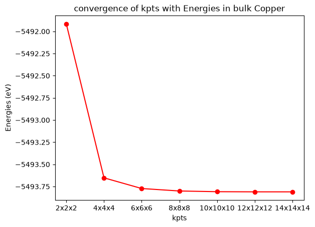

In the earlier tutorial, we converged the ecutwfc and ecutrho at a coarse arbitraty kpts (4,4,4) which we are not sure whether it is right or not for bulk Copper. In this tutorial, we will be converging the k-points. You can check the previous tutorials for guide on how to converge the ecutwfc and ecutrho and what they really mean.

You can refer to the earlier tutorials on how to build a bulk copper with the ase.build


```python
import os,numpy as np,glob #Here We have imported the numpy library, os module and glob module
from ase.build import bulk
from ase.spacegroup import crystal
from ase.calculators.espresso import EspressoProfile,Espresso

Bulk_Cu = crystal(symbols=["Cu"],basis = [[0,0,0]],cellpar=[3.6199]*3+[90]*3,spacegroup=225,primitive_cell=True)

#You can create a dedicated folder in your current working directory where these calculations will be saved if you want

os.makedirs(os.path.join(os.getcwd(),"kpt_cu_convergence_folder"),exist_ok=True)

profile = EspressoProfile(command = r"C:/Users/Test_PC/Downloads/qe-7.5-win-oneapi-msmpi/bin/pw.exe",
                          pseudo_dir = r"C:\Users\Test_PC\Downloads\all_pbe_UPF_v1.5")

pseudopotentials = {"Cu":"cu_pbe_v1.2.uspp.F.UPF"} 

input_data = {"calculation":"scf",
              "input_dft":"pbe",
              "ecutwfc": 60,
              "ecutrho":600,
              "etot_conv_thr":1e-6,
              "forc_conv_thr":2e-5,
              "conv_thr":1e-7,
             "occupations":"smearing",
             "smearing":"gaussian",
             "degauss":0.05,
             "tstress":True,
             "tprnfor":True}
kpts_to_test = [(2,2,2),(4,4,4),(6,6,6),(8,8,8),(10,10,10),(12,12,12),(14,14,14)]

for kpt in kpts_to_test:
    input_data.update({"prefix":f"cu_kpt_{kpt[0]}_{kpt[1]}_{kpt[2]}"})
    input_data.update({"outdir":"./"})
    calculator = Espresso(profile=profile,
                          directory = os.path.join(os.getcwd(),"kpt_cu_convergence_folder",f"cu_kpt_{kpt[0]}_{kpt[1]}_{kpt[2]}"),
                          kpts = kpt,
                          input_data = input_data.copy(),
                          pseudopotentials=pseudopotentials)
    Bulk_Cu.calc = calculator
    print(f"The single point energy for Bulk_Cu_kpt_{kpt[0]}_{kpt[1]}_{kpt[2]} is:", Bulk_Cu.get_potential_energy())

```

    The single point energy for Bulk_Cu_kpt_2_2_2 is: -5491.914709200717
    The single point energy for Bulk_Cu_kpt_4_4_4 is: -5493.651918505152
    The single point energy for Bulk_Cu_kpt_6_6_6 is: -5493.772398812014
    The single point energy for Bulk_Cu_kpt_8_8_8 is: -5493.800282997346
    The single point energy for Bulk_Cu_kpt_10_10_10 is: -5493.8082360685075
    The single point energy for Bulk_Cu_kpt_12_12_12 is: -5493.809915283006
    The single point energy for Bulk_Cu_kpt_14_14_14 is: -5493.810015420899
    

### Some Checks Before we plot: The pressure drops with increasing kpts

Before we plot the total energies, let's look at something quite important. If you check inside the Quantum ESPRESSO `.pwo` output files, you will see this statement but make sure you are checking toward the end of the file: **Computing stress (Cartesian axis) and pressure**.

* **Coarse Grid (`2x2x2`):** QE reported a massive **`243.33 kbar`** of artificial pressure and an energy of **`-5491.915 eV`**—even though the atoms doesnt moved.
* **Dense Grid (`14x14x14`):** That pressure dropped down to **`0.85 kbar`**, and the energy stabilized at about **`-5493.810 eV`**.

#### Why Did This Happen?
1. **Metals Need Dense kPoint Sampling:** Copper is a metal and its fermi surface needs much denser kpoints. A coarse `2x2x2` grid poorly samples the electrons' momentum space. This doesnt converged the total energy and the stress tensor that well.
2. **Static `scf` Keeps the simulation Box Frozen:** Because we ran a fixed-cell `scf` calculation, Quantum ESPRESSO isnt adjusting the lattice constant to relieve stress. Any artificial numerical stress just stays there until we feed it enough k-points.

#### Next Step: Finding the optimal kpoints
let's plot **Total Energy vs. k-Point Grid** to find the optimal kpts: the smallest k point mesh where the energy converges within **`1 meV` (`0.001 eV`)** which, looking at the numbers above (`-5493.8099 eV` at `12x12x12` vs. `-5493.8100 eV` at `14x14x14`), happens right around **`12x12x12`**!.

From the matplotlib plot, we can see the curve stays flat at around kpt 10x10x10 all through kpts 14x14x14. Any kpts within that is optimal for our system. 


```python
#we should have append the energies into a list for plotting before I ran the cell above but we didnt
from natsort import natsorted #You may have to pip install natsort. It is used to sort files in python
from ase.io import read
from matplotlib import pyplot as plt
Energies = []

"""neccessary_folders = [folder for folder in os.listdir(os.getcwd()) if folder.startswith("kpt_cu")][0]
print(neccessary_folders)
for root,folders,files in os.walk(neccessary_folders):
    for file in files:
        if "pwo" in file and "checkpoint" not in file:
            print(file)
for root,folders,files in os.walk(neccessary_folders):
    print(natsorted(folders))"""

pwo_files = natsorted(glob.glob(os.path.join(os.getcwd(),"*kpt_cu_con*","*cu_kpt*","*.pwo")))

kpt_label_to_plot = [f"{k[0]}x{k[1]}x{k[2]}" for k in kpts_to_test]

print(kpt_label_to_plot)

for file in pwo_files:
    energy = read(file,index=-1,format="espresso-out").get_potential_energy()
    Energies.append(energy)

plt.plot(kpt_label_to_plot,Energies,marker="o",color="red")
plt.title("convergence of kpts with Energies in bulk Copper",color="black")
plt.xlabel("kpts")
plt.ylabel("Energies (eV)")
```

    ['2x2x2', '4x4x4', '6x6x6', '8x8x8', '10x10x10', '12x12x12', '14x14x14']
    [-5491.914709200717, -5493.651918505152, -5493.772398812014, -5493.800282997346, -5493.8082360685075, -5493.809915283006, -5493.810015420899]
    [(2, 2, 2), (4, 4, 4), (6, 6, 6), (8, 8, 8), (10, 10, 10), (12, 12, 12), (14, 14, 14)]
    


    Text(0, 0.5, 'Energies (eV)')


    

    


```python
pip install natsort
```

    Collecting natsort
      Downloading natsort-8.4.0-py3-none-any.whl.metadata (21 kB)
    Downloading natsort-8.4.0-py3-none-any.whl (38 kB)
    Installing collected packages: natsort
    Successfully installed natsort-8.4.0
    Note: you may need to restart the kernel to use updated packages.
    

    
    [notice] A new release of pip is available: 26.2.2 -> 26.3
    [notice] To update, run: python.exe -m pip install --upgrade pip
    


```python
jupyter nbconvert --to markdown Convergence_Kpts_bulk_copper.ipynb

```
