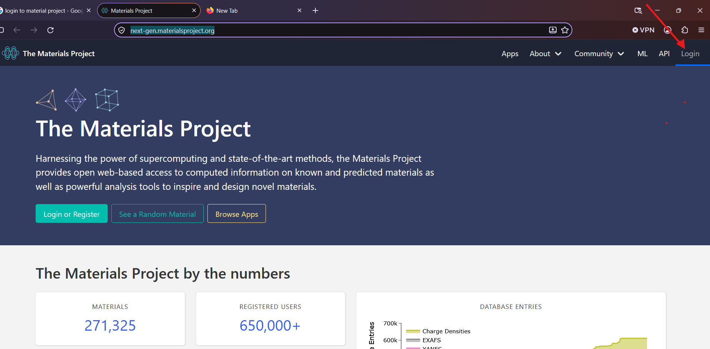
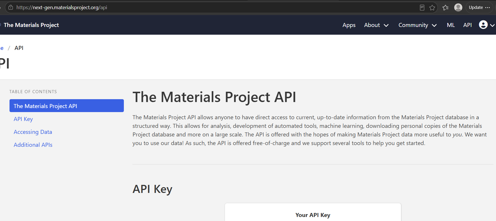
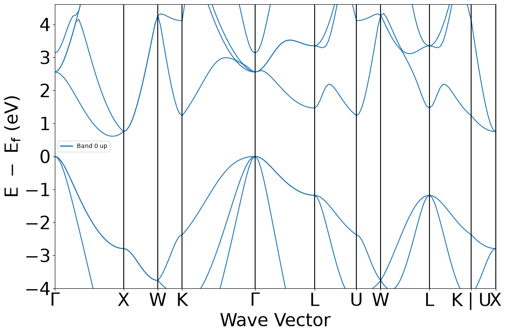
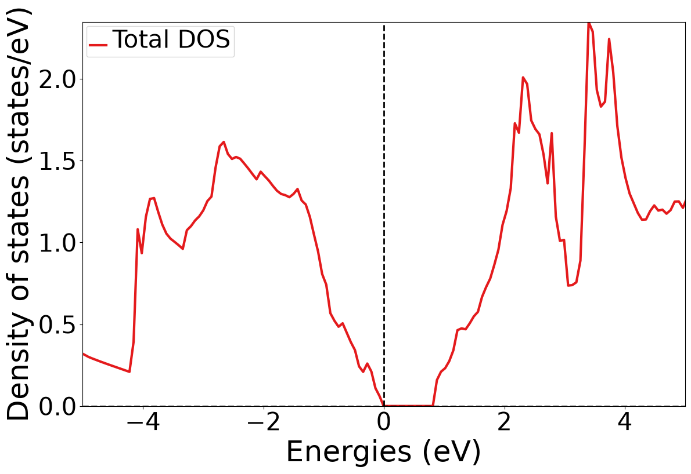

# From Materials Project to DFT: Fetching, Analyzing, and Visualizing Crystal Structures with Pymatgen & ASE

### This tutorial shows how to use Pymatgen (Python Materials Genomics) to import materials into your local machine for DFT simulation

*** Getting your API key : The API keys alow you to query the materials project database to get any crystal structure programatically. 

- First of all, you will go to the materials project website at https:`//next-gen.materialsproject.org/`. Click on `login` by the top right side of the page

  
  
- select the option you want to use to login. Could be email. and then create an acoount with a password.

  

- click on the `API key` by the top right or hover your mouse on your profile icon and select `my dashboard`, and you will be taken to where you can get your MP API key.

  
  
- You can use the code below to save your API key into a dedicated pymatgen yaml file called `.pmgrc.yaml` but you need to install the python client: `pip install mp-api` first 


```python
#pip install pymatgen #if you have not installed the pymatgen library
#pip install mp-api

```

#Then save your material project API keys permanently inside a file called `.pmgrc.yaml`


```python
import os

for root,folders,files in os.walk(os.getcwd()):
    for file in files:
        if "pmg" in file and "yaml" in file and "lnk" not in file: #if you are getting error here, it is possible that "lnk: is not in your path,
            #remove the "lnk" check. 
            print(file)
            with open(file,"w") as f:
                f.write("PMG_MAPI_KEY: key") #delete "key" here and simply paste the very long key you copied from the material project and hit "shift+enter" 
```

    .pmgrc.yaml
    

## The next step is to import the neccessary library from the pymatgen and the python client

* For instance you can import the `Neodymium magnetic` material from the database. Nd magnets are curently the strongest commercial permanent magnet. made from alloy of Neodymium,Boron and iron. The material project ID for NdFeB is `mp-616958`


```python
from pymatgen.electronic_structure.plotter import BSPlotter #This allows us to import band structure of material object
from pymatgen.electronic_structure.plotter import DosPlotter #allows us to import the density of state plot
from mp_api.client import MPRester #allows us to query the database
import os,numpy as np,glob
from pymatgen.io.ase import AseAtomsAdaptor as converter #sometimes I like to switch between an ASE atoms object and  a pymatgen atom object
with MPRester() as mpr: #usually you will input your MP key as a string "key" inside the MPRester but since we have already saved it permanently no need. 
    structure = mpr.get_structure_by_material_id("mp-616958") #the material project ID for Neodymium magnet
    print(structure) #You can print the structure to inspect it


```


<pre style="white-space:pre;overflow-x:auto;line-height:normal;font-family:Menlo,'DejaVu Sans Mono',consolas,'Courier New',monospace"><span style="color: #00bdad; text-decoration-color: #00bdad">✓ </span>Retrieved 1 MaterialsDoc documents<span style="color: #7a7a7a; text-decoration-color: #7a7a7a"> in 0.2s</span>
</pre>


    Full Formula (Nd8 Fe56 B4)
    Reduced Formula: Nd2Fe14B
    abc   :   8.628599   8.628599  12.750079
    angles:  90.000000  90.000000  90.000000
    pbc   :       True       True       True
    Sites (68)
      #  SP           a         b         c    magmom
    ---  ----  --------  --------  --------  --------
      0  Nd    0.234956  0.234956  0           -0.224
      1  Nd    0.695684  0.695684  0.5         -0.223
      2  Nd    0.265044  0.734956  0.5         -0.224
      3  Nd    0.195684  0.804316  0           -0.223
      4  Nd    0.804316  0.195684  0           -0.223
      5  Nd    0.734956  0.265044  0.5         -0.224
      6  Nd    0.304316  0.304316  0.5         -0.223
      7  Nd    0.765044  0.765044  0           -0.224
      8  Fe    0.197788  0.802212  0.249002     2.642
      9  Fe    0.197788  0.802212  0.750998     2.642
     10  Fe    0.523083  0.141712  0.322314     2.488
     11  Fe    0.243642  0.52966   0.881923     2.297
     12  Fe    0.476917  0.858288  0.677686     2.488
     13  Fe    0.5       0         0.5          2.402
     14  Fe    0.256358  0.02966   0.381923     2.297
     15  Fe    0.97034   0.743642  0.618077     2.297
     16  Fe    0         0         0.094308     2.165
     17  Fe    0.976917  0.641712  0.822314     2.488
     18  Fe    0         0         0.905692     2.165
     19  Fe    0.358288  0.023083  0.177686     2.488
     20  Fe    0.476917  0.858288  0.322314     2.488
     21  Fe    0.02966   0.256358  0.381923     2.297
     22  Fe    0.858288  0.476917  0.322314     2.488
     23  Fe    0.141712  0.523083  0.677686     2.488
     24  Fe    0.743642  0.97034   0.381923     2.297
     25  Fe    0.099876  0.099876  0.760517     2.174
     26  Fe    0.756358  0.47034   0.118077     2.297
     27  Fe    0.697788  0.697788  0.749002     2.642
     28  Fe    0.5       0.5       0.405692     2.165
     29  Fe    0.47034   0.756358  0.118077     2.297
     30  Fe    0.358288  0.023083  0.822314     2.488
     31  Fe    0.302212  0.302212  0.749002     2.642
     32  Fe    0.900124  0.900124  0.760517     2.174
     33  Fe    0.141712  0.523083  0.322314     2.488
     34  Fe    0.599876  0.400124  0.739483     2.174
     35  Fe    0.641712  0.976917  0.822314     2.488
     36  Fe    0.256358  0.02966   0.618077     2.297
     37  Fe    0.743642  0.97034   0.618077     2.297
     38  Fe    0.400124  0.599876  0.739483     2.174
     39  Fe    0.900124  0.900124  0.239483     2.174
     40  Fe    0.976917  0.641712  0.177686     2.488
     41  Fe    0.47034   0.756358  0.881923     2.297
     42  Fe    0.802212  0.197788  0.750998     2.642
     43  Fe    0.97034   0.743642  0.381923     2.297
     44  Fe    0.52966   0.243642  0.118077     2.297
     45  Fe    0.099876  0.099876  0.239483     2.174
     46  Fe    0.023083  0.358288  0.177686     2.488
     47  Fe    0.5       0         0            2.402
     48  Fe    0.243642  0.52966   0.118077     2.297
     49  Fe    0.52966   0.243642  0.881923     2.297
     50  Fe    0.858288  0.476917  0.677686     2.488
     51  Fe    0.5       0.5       0.594308     2.165
     52  Fe    0.697788  0.697788  0.250998     2.642
     53  Fe    0.523083  0.141712  0.677686     2.488
     54  Fe    0.02966   0.256358  0.618077     2.297
     55  Fe    0.641712  0.976917  0.177686     2.488
     56  Fe    0.599876  0.400124  0.260517     2.174
     57  Fe    0.302212  0.302212  0.250998     2.642
     58  Fe    0.756358  0.47034   0.881923     2.297
     59  Fe    0.023083  0.358288  0.822314     2.488
     60  Fe    0.802212  0.197788  0.249002     2.642
     61  Fe    0.400124  0.599876  0.260517     2.174
     62  Fe    0         0.5       0.5          2.402
     63  Fe    0         0.5       0            2.402
     64  B     0.572545  0.427455  0           -0.072
     65  B     0.072545  0.072545  0.5         -0.072
     66  B     0.927455  0.927455  0.5         -0.072
     67  B     0.427455  0.572545  0           -0.072
    

# The imported structure contains the following:
- Full formula: This is the complete formula of your imported structure. The conventional cell of NdBFe contains 8 Nd, 56 Fe and 4 Boron.
- Reduced formula: The reduced formula represents the simplest chemical ratio of the elements
- lattice constant (abc): This is the lenght of the lattice vector (already printed as scalar). In a tetragonal cell like NdBFe, a is the lenght of the simulation cell along the x axis, b is the lenght along $y$ and c is the height. also $a=b$.
- PBC (`True,True,True`) : periodic boundary condition. periodic codes like VASP used to compute this material obeys PBC in all 3 direction. It is just a mathematical trick to allow us simulate infinite crystal within a finite simulation box
- atomic coordinates for each element are also printed along with their respective `magnetic moment` values. `Iron (Fe)` provides the bulk of the magnetic property in this material. That is why the value is larger. The positive value (spin up) and negative value (spin down). 


```python
print(len(structure)) # You can get the total elements in the structure

#Also if you want to know how many Nd, Fe, or B are there, you can do this

Nd_idx = [atom.index for atom in converter.get_atoms(structure) if atom.symbol=="Nd"] #I try to convert the structure pymatgen object to ASE to get
#the index so I can count how many Nd there are. I am not sure the typical python .index method works directly on pymatgen atoms object

Fe_idx = [atom.index for atom in converter.get_atoms(structure) if atom.symbol=="Fe"]

print(len(Fe_idx)) # printing this will allow you count how many Fe there are. 

B_idx = [atom.index for atom in converter.get_atoms(structure) if atom.symbol=="B"]

#print(B_idx) #This shows the exact index for Boron

B_magmom = converter.get_atoms(structure).get_initial_magnetic_moments()[B_idx]

print(B_magmom)
```

    68
    56
    [-0.072 -0.072 -0.072 -0.072]
    

# We can find out which of the atom actually has the highest average magnetic moment 


```python
B_magmom = converter.get_atoms(structure).get_initial_magnetic_moments()[B_idx]

Fe_magmom = converter.get_atoms(structure).get_initial_magnetic_moments()[Fe_idx]

Nd_magmom = converter.get_atoms(structure).get_initial_magnetic_moments()[Nd_idx]

print("The average magnetic moment for all Boron atoms is",np.mean(B_magmom))

print("The average magnetic moment for all Iron atoms is",np.mean(Fe_magmom))

print("The average magnetic moment for all Neodymium atoms is",np.mean(Nd_magmom))


```

    The average magnetic moment for all Boron atoms is -0.072
    The average magnetic moment for all Iron atoms is 2.381357142857143
    The average magnetic moment for all Neodymium atoms is -0.2235
    

### We can convert the structure to a cif file or a quantum espresso input file or a vasp input file (poscar). 
***The crystalographic infomation file (cif) allows us to visualize the crystal structure in a 3D visualizer program such as VESTA***

To download Vesta:

- Go to this website : `https://jp-minerals.org/vesta/en/download.html`
- scroll down and select your operating system (MacOS, Windows or Linux) and the file will be downloaded to your local.
- Go to the downloaded file to extract and then click on the application to open.
- Then open the NdFeB cif file that you created below in the Vesta program.


```python
structure.to(os.path.join(os.getcwd(),"NdFeB.cif"),fmt="cif") #This saves the file to your current working directory

#or you can create a dedicated folder for it like this :

#structure.to(os.makedirs(os.path.join(os.getcwd(),"Nd_magnet_folder","NdFeB.cif")),fmt="cif")

#or if you want to use the Atomic simulation enviroment

ase_objects = converter.get_atoms(structure)

from ase.io import write

write(os.path.join(os.getcwd(),"Nd_ase_magnet.cif"),ase_objects,format="cif")

#You can view the cif file in a text editor..probably a Notepad on windows

#os.startfile(os.path.join(os.getcwd(),"Nd_ase_magnet.cif")) #This launches a notepad application. check at the bottom of the screen to allow

[Download the generated Nd₂Fe₁₄B CIF file](/files/NdFeB.cif)


```

# Now we can print the band structure of this material and do some fun with the band structure objects


```python
band_structure = mpr.get_bandstructure_by_material_id("mp-616958")
```


<pre style="white-space:pre;overflow-x:auto;line-height:normal;font-family:Menlo,'DejaVu Sans Mono',consolas,'Courier New',monospace"><span style="color: #00bdad; text-decoration-color: #00bdad">INFO    </span> Fetching the setyawan_curtarolo band structure for mp-616958...                                           
</pre>


    ---------------------------------------------------------------------------

    MPRestError                               Traceback (most recent call last)

    Cell In[6], line 1
    ----> 1 band_structure = mpr.get_bandstructure_by_material_id("mp-616958")
    

        [... skipping hidden 1 frame]
    

    File ~\AppData\Local\Python\pythoncore-3.15-64\Lib\site-packages\mp_api\client\mprester.py:1493, in MPRester.get_bandstructure_by_material_id(self, material_id, path_type, line_mode, load_projections)
       1474 def get_bandstructure_by_material_id(
       1475     self,
       1476     material_id: str,
       (...)   1479     load_projections: bool = False,
       1480 ):
       1481     """Get the band structure pymatgen object associated with a Materials Project ID.
       1482 
       1483     Arguments:
       (...)   1491         bandstructure (BandStructure | BandStructureSymmLine): BandStructure or BandStructureSymmLine object
       1492     """
    -> 1493     return self.materials.electronic_structure_bandstructure.get_bandstructure_from_material_id(  # type: ignore
       1494         material_id=material_id,
       1495         path_type=path_type,
       1496         line_mode=line_mode,
       1497         load_projections=load_projections,
       1498     )
    

        [... skipping hidden 1 frame]
    

    File ~\AppData\Local\Python\pythoncore-3.15-64\Lib\site-packages\mp_api\client\routes\materials\electronic_structure.py:376, in BandStructureRester.get_bandstructure_from_material_id(self, material_id, path_type, line_mode, load_projections)
        371     raise MPRestError(
        372         f"No electronic structure data found for material ID {material_id}."
        373     )
        375 if (_bs_data := bs_doc[0]["bandstructure"]) is None:
    --> 376     raise MPRestError(
        377         f"No {pt.value} band structure data found for {material_id}"
        378     )
        380 bs_data = (
        381     _bs_data.model_dump() if self.use_document_model else _bs_data  # type: ignore
        382 )
        384 if bs_data.get(pt.value, None) is None:
    

    MPRestError: No setyawan_curtarolo band structure data found for mp-616958


### It seems the materials project doesnt have a precomputed band structure infomation for this material. For the purpose of this tutorial, we can fall back on a different structure for now:


```python
material_id = "mp-616958"

fall_back_material_id = "mp-149" # we can fall back on Silicon 
try:
    band_structure = mpr.get_bandstructure_by_material_id(material_id)

    Image = BSPlotter(band_structure).show()
except Exception as e:
    print("Error! Error! Error!. Reason:",e)
    print(f"\nSkipping material {material_id}")

    print(f"\nFalling back on Silicon with material id",fall_back_material_id)

    bs = mpr.get_bandstructure_by_material_id(fall_back_material_id)

    Picture = BSPlotter(bs).show()

    band_gap = bs.get_band_gap()

    print("\nThe band gap for the Silicon you fetched is:",band_gap["energy"])

    print("\nBe reminded that the functional used in this calculation is one thar typically underestimate the real quasiparticle band gap")

    print(f"\nIs this material a metal?" ,bs.is_metal()) #This prints false if it is not.

    dos = mpr.get_dos_by_material_id(fall_back_material_id)

    #dos_picture = DosPlotter(dos).show()

    dos_picture = DosPlotter(dos)
    dos_picture.add_dos("Total DOS",dos)
    
    dos_picture.get_plot(xlim=(-5, 5)) #Totall DOS

    #dos_picture.get_plot(xlim=(-5, 5))
    
    
```


<pre style="white-space:pre;overflow-x:auto;line-height:normal;font-family:Menlo,'DejaVu Sans Mono',consolas,'Courier New',monospace"><span style="color: #00bdad; text-decoration-color: #00bdad">INFO    </span> Fetching the setyawan_curtarolo band structure for mp-616958...                                           
</pre>


    Error! Error! Error!. Reason: No setyawan_curtarolo band structure data found for mp-616958
    
    Skipping material mp-616958
    
    Falling back on Silicon with material id mp-149
    


<pre style="white-space:pre;overflow-x:auto;line-height:normal;font-family:Menlo,'DejaVu Sans Mono',consolas,'Courier New',monospace"><span style="color: #00bdad; text-decoration-color: #00bdad">INFO    </span> Fetching the setyawan_curtarolo band structure for mp-149...                                              
</pre>


    

    


    
    The band gap for the Silicon you fetched is: 0.6105
    
    Be reminded that the functional used in this calculation is one thar typically underestimate the real quasiparticle band gap
    
    Is this material a metal? False
    


<pre style="white-space:pre;overflow-x:auto;line-height:normal;font-family:Menlo,'DejaVu Sans Mono',consolas,'Courier New',monospace"><span style="color: #00bdad; text-decoration-color: #00bdad">INFO    </span> Fetching the density of states for mp-149...                                                              
</pre>


    

    


```python
!jupyter --nb convert
```
