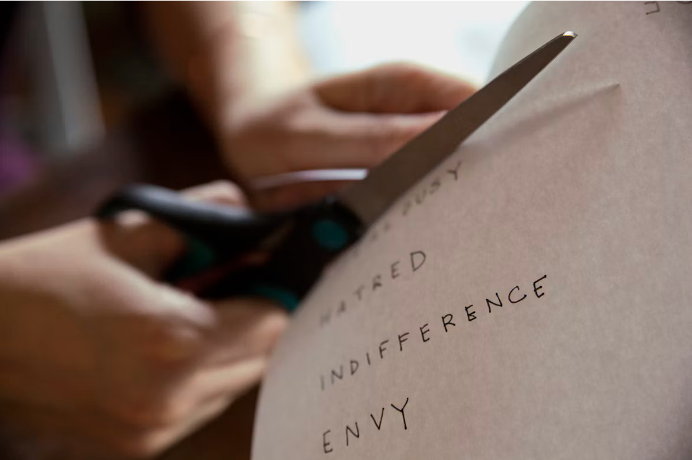

> ***Envy is that which takes light away from your face. Contentment is that which satisfy your souls and restore your light.***
---

*Photo by [Megan Watson](https://unsplash.com) on [Unsplash](https://unsplash.com)*

Envy is as old as man. From the primitive hunter and gatherer to the sophisticated man who build sky scrapper and launch satellites into space, the idea of envy and its attendant harm has not changed. From the viewpoint of the envier, they can't rationalize why they feel that way other than the fact that they deserve as much as the other person got, or that the other person doesn't merit what they got. Sometimes, the other person doesn't even needs to get so much to be envied. They just need to exist. Envy can push the envier to harm the envied. Envy can push the envier to plot the downfall of the ones they envied. Envy can do so much more and it doesn't need much justification. Envy doesn't only harm the envied, it also poses danger to the envier in obvious ways. 

**The Psychological Effect of Envy**

Envy is two faced. First, the envier feels so disturbed, so angry inside, so nervous and depressed upon realizing that the object of their envy still exist and blooming. Second, the envied, without realizing it, might become the objects of the many schemes the envier is planning. The envier is always sad, always scared, always nervous. No peace. Until the subject of their envy either experience sharp misfortune that causes their light to wane or cease to exist within the vicinity of the favor the envier detest them for. 

It is unlikely that humans will be able to eliminate one or more forms of envy completely from their life, but being fortunate enough to notice it might be a good step towards curtailing it. When you notice you are just sad for no reason other than "this person doesn't deserve this much goodness, I do." then you know envy is creeping in. And you need to re-evaluate why you dislike this person so much that you started wishing they fall out of favor. Envy is almost always a sign you feel you are inadequate. It is an insecurity that makes you doubt yourself. You have lost hope in your own ability. You need to retroactively take stock of the past and look at the things you were once grateful for. Being contented while actively pursuing your own goals of being better, of being worthy, will allow you take a much more decent look of why you are being envious of the other person in the first place. 

The following actions might help you evaluate where you are and how to take control

- **Are you always sad anytime you realize someone close to you has what you don't have?**

You must realize this is part of life. Do not beat yourself up for it. The fact that you feel this way doesn't mean you should act on it. It doesn't      mean you should start planning their failure. Appreciate what they have and be happy for them. Life alternate those days of merited favor among humans      and that is enough to make you take better account of your feelings. It is their time. They have worked hard for this day. They deserve it. Any time you    feel bad about what they have, remind yourself whether you want others to either be happy for you or be sad when your time comes.
  
- **Redirect your thought to something positive:**
  
Whenever these thoughts rush in, direct them to something productive. Reflect on those things you are most grateful for. Your family. Your business. The love you receive from others and the one time someone appreciated you for making their life better. The one time someone smiled because of what you did, because of you. Those are what you are grateful for. That is you. Someone who stood by others. Someone who guide others with their light.

  ---

  > *It is unlikely that humans will be able to permanently eliminate feelings of envy from their life. But being able to recognize it goes a long way           towards better accountability and being in control of your own happiness.*

